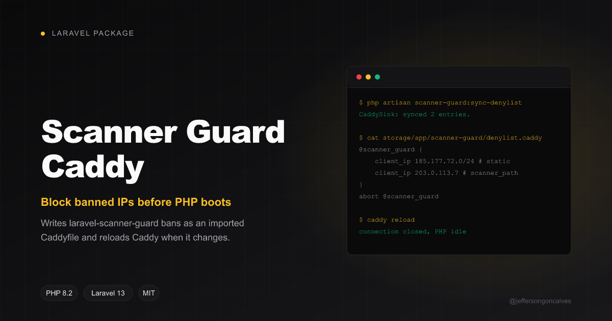

<div class="filament-hidden">



</div>

# Laravel Scanner Guard Caddy

[](https://packagist.org/packages/jeffersongoncalves/laravel-scanner-guard-caddy)
[](https://github.com/jeffersongoncalves/laravel-scanner-guard-caddy/actions/workflows/tests.yml)
[](https://packagist.org/packages/jeffersongoncalves/laravel-scanner-guard-caddy)

Caddy denylist sink for [`laravel-scanner-guard`](https://github.com/jeffersongoncalves/laravel-scanner-guard).
Writes every banned IP and `ip_blocklist` entry as a Caddyfile snippet, so banned scanners have their
connection closed by Caddy before PHP boots. Requires Caddy 2.7+. On FrankenPHP or Laravel Octane, use
[`laravel-scanner-guard-frankenphp`](https://github.com/jeffersongoncalves/laravel-scanner-guard-frankenphp).

```caddyfile
@scanner_guard {
	client_ip 185.177.72.0/24 # static
	client_ip 203.0.113.7 # scanner_path, expires 2026-11-20T10:00:00+00:00
}
abort @scanner_guard
```

## Installation

```bash
composer require jeffersongoncalves/laravel-scanner-guard-caddy
```

Add the sink to `config/scanner-guard.php`:

```php
'sinks' => [
    \JeffersonGoncalves\ScannerGuardCaddy\CaddySink::class,
],
```

`import` the file from your Caddy site block:

```caddyfile
{
	order abort first
}

example.com {
	import /var/www/html/storage/app/scanner-guard/denylist*.caddy
	# ...
}
```

- Keep the `*`: Caddy refuses to start when a plain `import` path doesn't exist yet, while a glob that
  matches nothing is fine.
- Keep `order abort first`: by default Caddy runs `handle`, `handle_path` and `route` blocks before
  `abort`, so requests they match would skip the denylist.
- Caddy's user must be able to read the file, including its parent directories.

`scanner-guard:sync-denylist` now runs every minute, and right after every ban, unban and blocklist
change (see the core README's "Blocking before PHP" section).

## Configuration

```bash
php artisan vendor:publish --tag="laravel-scanner-guard-caddy-config"
```

| Key | Env | Default | |
|---|---|---|---|
| `path` | `SCANNER_GUARD_CADDY_PATH` | `storage/app/scanner-guard/denylist.caddy` | relative to `base_path()` |
| `reload_command` | `SCANNER_GUARD_CADDY_RELOAD_COMMAND` | `null` | e.g. `caddy reload --config /etc/caddy/Caddyfile` |

The file is only rewritten when its content changes, through a temp file renamed over the target,
so Caddy never reads a half-written list. Caddy only re-reads an `import`ed file on reload: the
`reload_command` runs after a write, never otherwise. A non-zero exit or a timeout is logged, never
thrown.

`caddy reload` talks to Caddy's admin API (`localhost:2019` by default), so it needs no `sudo`: the
PHP user (and your queue worker, if different) only has to read the Caddyfile. It parses the
Caddyfile in **its own** environment: if yours uses `{$VAR}` placeholders, those variables must also
be set for the PHP user, or the reload loads them empty. With systemd, reloading the service avoids
that. Allow it in `/etc/sudoers.d/scanner-guard`:

```
www-data ALL=NOPASSWD: /usr/bin/systemctl reload caddy
```

and set the command to `sudo systemctl reload caddy`.

In a container where PHP can't reach Caddy, leave the command empty, share the denylist directory
with the Caddy container and start Caddy with `--watch`: it follows imported files too.

### Behind a proxy or CDN

`client_ip` is the connecting address unless Caddy trusts the proxy. Behind Cloudflare or a load
balancer, set `trusted_proxies` (and `client_ip_headers Cf-Connecting-Ip` for Cloudflare), trusting
only the proxy's ranges:

```caddyfile
{
	servers {
		trusted_proxies static 173.245.48.0/20 # ... https://www.cloudflare.com/ips/
		client_ip_headers Cf-Connecting-Ip
	}
}
```

Otherwise the denylist never matches a visitor. Cloudflare shows an aborted connection as a `520`
error page.

## Testing

```bash
composer test
```

## Changelog

Please see [CHANGELOG](CHANGELOG.md) for more information on what has changed recently.

## Credits

- [Jefferson Gonçalves](https://github.com/jeffersongoncalves)
- [All Contributors](../../contributors)

## License

The MIT License (MIT). Please see [License File](LICENSE.md) for more information.
